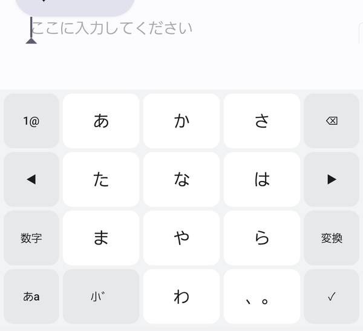
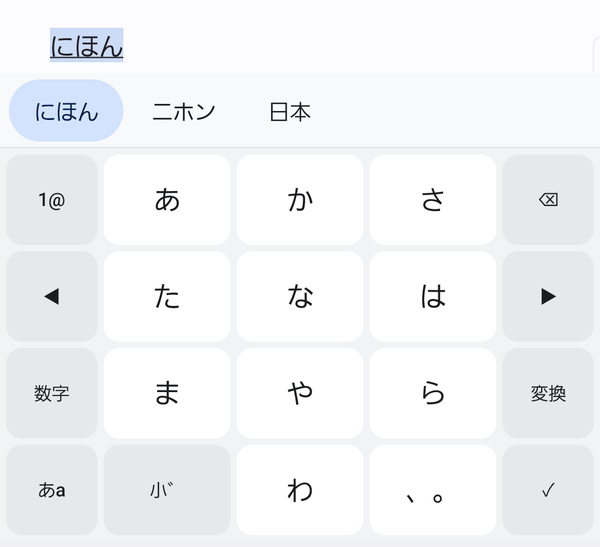
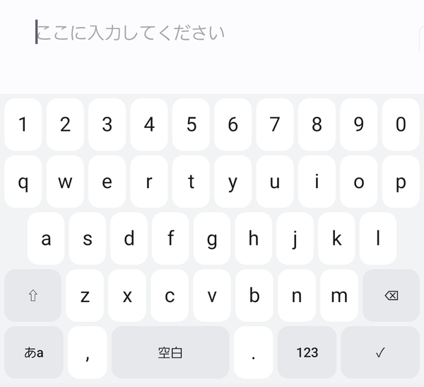
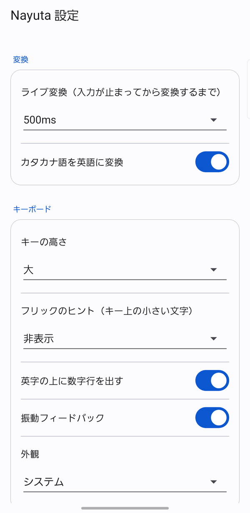

# Nayuta

BERT を使って日本語入力を変換する Android IME（試作）。

一般的な IME の予測変換を**トークン（文節）単位に区切り**、その前後の文脈を
BERT に読ませて「どの表記が自然か」を採点する。予測で文字列を生成するのではなく、
**辞書が持つ候補を文脈で選び直す**（リランカー）方式を採っている。


*`にほん` と入力 → ライブ変換で `日本` → `変換` で文節ごとの候補*

## できること

- **かな 12 キーフリック入力**（標準フリック: い=左 / う=上 / え=右 / お=下）
- **英字 QWERTY**（数字行の表示は設定で切替、Shift、記号ページ）
- **ライブ変換** — 入力が止まって 500ms で自動変換（待ち時間は設定可、オフも可）
- **単語ごとの変換** — 文節の区切りを ◀▶ で調整し、候補をタップで選択
- **カタカナ語 → 英語** — `あんどろいど` → `Android`
- **端末内オンライン学習** — 確定のたびに「自分の癖」だけを学習（[詳細](docs/online-learning.md)）
- ダークモード、キーの高さ・振動・ヒント表示の設定

すべて**端末内で完結**する。ネットワーク通信なし、パーミッション要求なし。

## スクリーンショット

| かな（12 キーフリック） | 単語ごとの変換 |
|---|---|
|  |  |

| 英字（QWERTY + 数字行） | 設定（Material 3） |
|---|---|
|  |  |

スクリーンショットはアプリ内の**テスト入力画面**で撮影しています（個人情報を含みません）。

## 仕組み

```
入力（かな）
   ↓
単語ラティス構築（辞書 22万語 + ユーザー辞書 + 英単語 + 未知語）
   ↓
Viterbi 探索（単語 bigram 連接コスト付き）
   ↓  N-best 経路
BERT 再ランク（文字レベル BERT で各スパン×候補を文脈採点）
   ↓
表示・確定
```

- モデル: `tohoku-nlp/bert-base-japanese-char-v3` をファインチューニングした
  スパン採点器（6 層 / hidden 384 / 語彙 7027）
- 端末推論: int8 量子化した ONNX（14.2MB）+ ONNX Runtime
- 再ランクは 2 段階（unigram ビーム探索で候補経路を作り、その中のスパンを採点）

## 精度と速度

評価: 日本語 Wikipedia から作った検証 2,000 文（文正解率）

| 構成 | 文正解率 |
|---|---|
| unigram ビーム探索のみ | 35.95% |
| ＋ BERT 再ランク | 45.45% |
| ＋ bigram 連接コスト ＋ BERT | **53.45%** |

- 到達可能な上限（正解が候補経路に含まれる率）: 70.70%
- 正解分割を与えた場合の候補選択精度: 93.67%
- 実機（AQUOS sense6 / Android 16）での変換時間: **定常 7〜11ms**、
  初回のみ 350〜960ms（辞書・モデルの読み込み）

## リポジトリ構成

```
docs/       設計書と実験レポート
train/      BERT スパン採点器の学習・評価・書き出し（Python）
android/    IME 本体（Kotlin）
scripts/    SDK セットアップとビルド
```

学習済みモデルと辞書（合計 30MB 程度）は**リポジトリに含めていない**。
下の手順で生成する（または Releases の APK を使う）。

## ビルド

### 1. 必要なもの

- JDK 21、Android SDK（`scripts/android/setup_sdk.sh` が `./.android-sdk` に入れる）
- Python 3.12 + uv（`uv sync`）

### 2. 学習済みアセットを生成

```bash
# 1) コーパスから辞書と学習データを作る（日本語 Wikipedia の dump を data/raw に置く）
python -m train.prep_data

# 2) 辞書を育てる（SudachiDict の活用形＋読みの揺れ）
python -m train.build_lex_v2 --variant-penalty 4.5

# 3) カタカナ語→英単語（JMdict）
python -m train.build_english_lexicon

# 4) BERT スパン採点器を学習（GPU 推奨）
python -m train.train --arch scratch-small --lexicon lexicon_v2.tsv --alt-prob 0.25

# 5) 端末用アセットを書き出す
python -m train.export_dict          # assets/dict/lexicon.tsv.gz
python -m train.build_bigram         # data/bigram.tsv
python -m train.export_bigram        # assets/dict/bigram.bin
python -m train.export_onnx_online   # assets/model/scorer.onnx（int8）
```

### 3. APK をビルドして入れる

```bash
bash scripts/android/build.sh
adb install -r android/app/build/outputs/apk/debug/app-debug.apk
adb shell ime enable com.nayuta.ime/.NayutaImeService
adb shell ime set    com.nayuta.ime/.NayutaImeService
```

APK は約 54MB（ONNX Runtime のネイティブライブラリが大半）。

## 使い方

起動すると設定画面が開く。`テスト入力画面` からキーボードの動作を確認できる。

| 操作 | 動き |
|---|---|
| かな入力 | 12 キーフリック。`1@` で数字・記号ページ |
| `あa` / `123` | かな ⇄ 英字 ⇄ 数字・記号 |
| 変換 | 文節ごとの変換モード。候補をタップで決定、◀▶ で区切り調整 |
| ✓ | 未確定があれば確定、なければ改行（単一行なら検索・送信） |
| 長押し ⌫ | 連続削除 |

### 設定

`設定` から、ライブ変換の待ち時間 / カタカナ語の英語化 / キーの高さ /
フリックのヒント / 振動 / 外観 / 数字行の表示 / 学習のリセット を変更できる。

## パーソナライズ（端末内オンライン学習）

BERT 本体は凍結し、**最後の薄い線形層だけ**を確定のたびに端末内で更新する。

```
スコア = BERT の元スコア + Σ_d w_d · h_d · c_d
```

学習対象は 384 次元の `w` のみ。初期値 0 のため、学習前は通常の変換と完全に同じ挙動になる。
仕組みと実測は [docs/online-learning.md](docs/online-learning.md)。

## 設計と実験の記録

- [docs/design.md](docs/design.md) — 全体設計（文字＝モデル / 単語＝探索 / 文節＝UI）
- [docs/m0-results.md](docs/m0-results.md) — BERT 採点の効果と文脈の寄与
- [docs/m2-step-a.md](docs/m2-step-a.md) / [docs/m2-step-b.md](docs/m2-step-b.md) — 端末実装と bigram の効果
- [docs/online-learning.md](docs/online-learning.md) — オンライン学習

## 既知の制約

- 変換精度は実用水準にはまだ遠い（文正解率 53%）。話し言葉・SNS 文体に弱い
- 学習は単語モードの確定時のみ（通常の変換確定では文節境界が取れないため）
- 端末は arm64-v8a のみ

## ライセンス

コードは **Apache License 2.0**。詳細は [LICENSE](LICENSE) と
第三者ライセンスの [NOTICE](NOTICE) を参照。

同梱・生成するデータの一部は別ライセンス:

| 対象 | ライセンス |
|---|---|
| 本リポジトリのコード | Apache-2.0 |
| カタカナ語→英単語 辞書（JMdict 由来） | CC BY-SA 4.0 |
| 学習済みモデル（`bert-base-japanese-char-v3` 由来） | Apache-2.0 |
| 辞書（SudachiDict 由来） | Apache-2.0 |
| 学習コーパス（日本語 Wikipedia） | CC BY-SA 4.0 |
