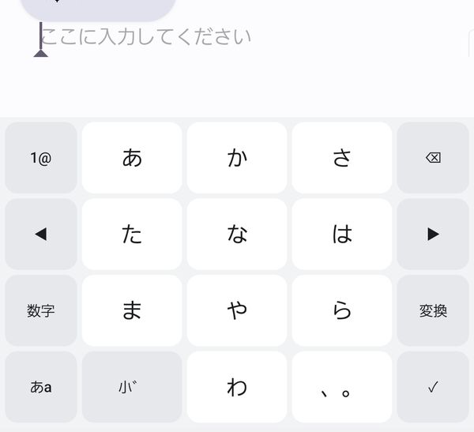
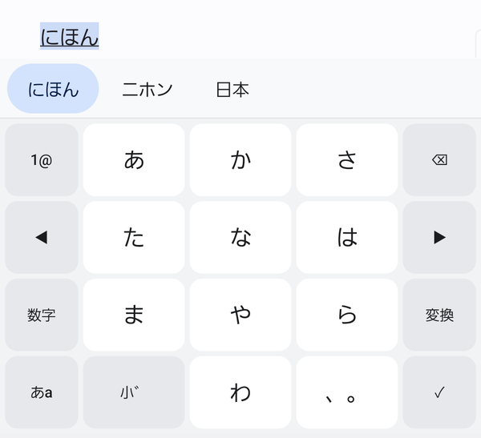
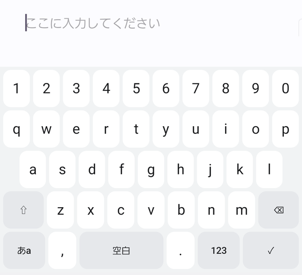
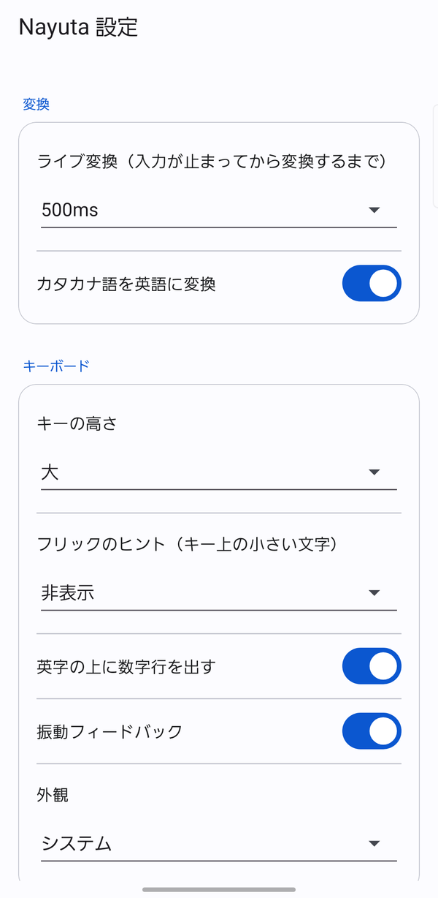

# Nayuta

BERT を使って日本語入力を変換する Android IME（試作）。

一般的な IME の予測変換を**トークン（文節）単位に区切り**、その前後の文脈を
BERT に読ませて「どの表記が自然か」を採点する。予測で文字列を生成するのではなく、
**辞書が持つ候補を文脈で選び直す**（リランカー）方式を採っている。


*`にほん` と入力 → ライブ変換で `日本` → `変換` で文節ごとの候補*

## できること

- **かな 12 キーフリック入力**（標準フリック: い=左 / う=上 / え=右 / お=下）
- **小゛・や の Gboard 互換フリック** — 小゛: 上=小文字 / 左=濁点 / 右=半濁点、や: 左右=括弧
- **英字 QWERTY**（数字行の表示は設定で切替、Shift、記号ページ）
- **ライブ変換** — 入力が止まって 500ms で自動変換（待ち時間は設定可、オフも可）
- **単語ごとの変換** — 文節の区切りを ◀▶ で調整し、候補をタップで選択
- **カーソル移動** — ◀▶ のタップで左右、フリックで上下左右。左右は入力中も確定しない（上下は読みを確定して移動）
- **カタカナ語 → 英語** — `あんどろいど` → `Android`
- **端末内オンライン学習** — 確定のたびに「自分の癖」だけを学習（[詳細](docs/online-learning.md)）
- ダークモード、キーの高さ・振動・ヒント表示の設定

すべて**端末内で完結**する。ネットワーク通信なし、パーミッション要求なし。

## スクリーンショット

| かな（12 キーフリック） | 単語ごとの変換 |
|---|---|
|  |  |

| 英字（QWERTY + 数字行） | 設定（Material 3） |
|---|---|
|  |  |

スクリーンショットはアプリ内の**テスト入力画面**で撮影しています（個人情報を含みません）。

## 仕組み

```
入力（かな）
   ↓
単語ラティス構築（辞書 22万語 + ユーザー辞書 + 英単語 + 未知語）
   ↓
Viterbi 探索（単語 bigram 連接コスト付き）
   ↓  N-best 経路
BERT 再ランク（文字レベル BERT で各スパン×候補を文脈採点）
   ↓
表示・確定
```

- モデル: 文字レベル BERT のスパン採点器（6 層 / hidden 384 / 語彙 7027 / 14.0M パラメータ）。
  12 層の上限モデルから蒸留して学習し、int8 量子化して端末に載せる
- 端末推論: int8 量子化した ONNX（14.2MB）+ ONNX Runtime
- 再ランクは 2 段階（unigram ビーム探索で候補経路を作り、その中のスパンを採点）

## 精度と速度

評価: 固定評価セット 2,000 文。Wikipedia（[`data/eval/wiki2000.jsonl`](data/eval/wiki2000.jsonl)）と
国会会議録 = 話し言葉（[`data/eval/sns2000.jsonl`](data/eval/sns2000.jsonl)）。文正解率。

| 構成（beam 32 / want 48） | Wikipedia | 話し言葉 |
|---|---|---|
| unigram ビーム探索のみ | 38.80% | 16.55% |
| ＋ bigram 連接コスト | 55.45% | 65.15% |
| **＋ BERT 再ランク（v3）** | **57.10%** | **67.60%** |
| （参考）再学習前の v2 一式 | 53.55% | 42.45% |

- 天井（正解経路が辞書・候補内に存在）: **90.85%**（v2 は 84.95%）
- 正解が N-best に入る率: 71.40%（beam 32/48）/ 74.20%（beam 128/256）
- ビームを 128/256 に広げると Wikipedia **58.95%** / 話し言葉 **70.55%**（探索コストは約 4 倍）
- 実機（AQUOS sense6 / Android 16）での変換時間: **定常 7〜11ms**（v2 時点）。
  v3 は辞書が 14.5 万 → 50 万読みになるため、初回の辞書ロードが約 1.8s に増える見込み
- 詳細は [docs/retrain-v3.md](docs/retrain-v3.md)（辞書・コーパス・文脈・蒸留の切り分け）と
  [docs/phase0-ceiling.md](docs/phase0-ceiling.md)（天井の分解測定）

## リポジトリ構成

```
docs/       設計書と実験レポート
train/      BERT スパン採点器の学習・評価・書き出し（Python）
android/    IME 本体（Kotlin）
scripts/    SDK セットアップとビルド
.github/    CI（PR/master でビルド検証）とリリース（v* タグで pre-release 作成）
```

学習済みモデルと辞書（合計 30MB 程度）は**リポジトリに含めていない**。
下の手順で生成する（または Releases の APK を使う）。

## ビルド

### 1. 必要なもの

- JDK 21、Android SDK（`scripts/android/setup_jdk.sh` と `setup_sdk.sh` が
  `./.cache/jdk21` / `./.android-sdk` に入れる。sudo 不要）
- Python 3.12 + uv（`uv sync`）

手順の詳細は [docs/setup.md](docs/setup.md) を参照。最短手順:

```bash
uv sync
bash scripts/android/setup_jdk.sh
bash scripts/android/setup_sdk.sh
bash scripts/android/fetch_assets.sh   # 配布 APK からモデルと辞書を展開
bash scripts/android/build.sh
```

### 2. 学習済みアセットを生成

学習から作り直す場合の手順（GPU 推奨）。配布 APK から取り出すだけなら
`scripts/android/fetch_assets.sh` で済む。

```bash
# 1) コーパスを取得（Wikipedia 全量 / mC4 web / 国会会議録）
HF_HUB_DISABLE_XET=1 python -m train.fetch_corpus --what all

# 2) 学習データとコーパス辞書を作る
#    文脈は記事・ドキュメント単位で引き継ぐ（付与率 35% → 99%）
python -m train.prep_data \
    --source wiki:'data/raw/*.parquet' \
    --source web:'data/corpus/web/*.jsonl.gz' \
    --source sns:'data/corpus/sns/*.jsonl.gz' --lines-per-doc 5

# 3) 辞書を育てる（SudachiDict full + NEologd + Wikipedia タイトル）
python -m train.build_lex_v3 --corpus-lexicon data/lexicon.tsv \
    --variant-penalty 6.0 --default-cost 18.0 --topk 8 \
    --max-readings 500000 --max-rows 1200000 --max-size-mb 30

# 4) 上限モデル（12 層）を学習 → 6 層へ蒸留（GPU 推奨）
python -m train.train --arch scratch-12l --k 8 \
    --lexicon lexicon_v3.tsv --alt-prob 0.25 --hard-neg-prob 0.5 \
    --out models/scorer_12l_v3.pt
python -m train.train --arch scratch-small --k 8 \
    --lexicon lexicon_v3.tsv --alt-prob 0.25 --hard-neg-prob 0.5 \
    --distill-teacher models/scorer_12l_v3.pt --distill-alpha 0.5 \
    --out models/scorer_v3.pt

# 5) 端末用アセットを書き出す（v3 は 1 コマンドにまとめてある）
bash scripts/export_v3_assets.sh
```

> 英語候補機能（JMdict 由来）は品質上の理由で無効です。
> `train.build_english_lexicon` は実行せず、`english.tsv(.gz)` も生成しません。

### 3. APK をビルドして入れる

```bash
bash scripts/android/build.sh
adb install -r android/app/build/outputs/apk/debug/app-debug.apk
adb shell ime enable com.nayuta.ime/.NayutaImeService
adb shell ime set    com.nayuta.ime/.NayutaImeService
```

APK は約 54MB（ONNX Runtime のネイティブライブラリが大半）。

### 4. リリース（CI/CD が自動で実行）

**PR を master にマージするだけで**、`v<versionName>-pre`（現バージョンなら `v0.2.5-pre`）の pre-release に
`nayuta-v<version>-debug.apk` が自動で添付（または上書き）される。
`v*` タグの push や、Actions 画面から「Release」の手動実行でも同じことができる。
モデル・辞書のアセットは「自分を除く最新リリース」から自動取得する（`scripts/android/fetch_assets.sh`）。
PR と master への push では `.github/workflows/ci.yml` が `assembleDebug` + `lintDebug` を実行し、
APK をビルド成果物（artifact）として保存する。

バージョンを上げるには `android/app/build.gradle.kts` の `versionName` / `versionCode` を編集してマージする。
詳しい運用は [docs/ci-cd.md](docs/ci-cd.md) を参照。

## PC で変換を試す（CLI）

端末と同じ 2 段階（ビーム探索 → BERT 再ランク）を PC で回して、変換結果と精度を
その場で確認できる。アセットは `data/` と `android/app/src/main/assets/` から自動で探す
（無ければ `bash scripts/android/fetch_assets.sh` で展開する）。

```bash
# 1 回だけ変換（読みはひらがな。カタカナも可）
python -m train.cli convert にほんごのへんかんせいど
python -m train.cli convert --text きょうはいいてんきですね --context "おはよう、"

# 対話モード（モデルのロードは 1 回だけ。:ctx / :beta / :preset などを変更できる。
# 全角の「：」でも動く。:top のように値を省くと現在値の表示）
python -m train.cli repl

# 評価セットで文正解率・CER・誤り一覧（--limit 0 で全件、--json-out で保存）
python -m train.cli eval --data data/eval/wiki2000.jsonl --limit 200

# 「する」接続（記者する / 帰社する など）の曖昧性だけを集めた評価セットを作る
python -m train.make_suru_eval --limit 300
python -m train.cli eval --data data/eval/suru_amb.jsonl --limit 300
```

条件はプリセットで切り替える。

| プリセット | 仮説の生成 | 重み | 想定 |
|---|---|---|---|
| `--preset wiki`（既定） | bigram ビーム | delta=1.0, beta=0.5 | Wikipedia 57.10% |
| `--preset sns` | bigram ビーム | delta=2.0, beta=2.0 | 話し言葉 67.60% |
| `--preset device` | unigram ビーム | beta=1.2 | Android の `LatticeConverter` と同じ条件 |

`--preset device` は端末と同じアセット・同じ式で動く（ユーザー辞書・カタカナ→英語・
オンライン学習は端末のみのため含まない）。出力の所要時間は PC の Python 実測なので、
実機の 7〜11ms とは比較できない。`--no-bert` / `--no-bigram` で各段の寄与も見られる。

## 使い方

起動すると設定画面が開く。`テスト入力画面` からキーボードの動作を確認できる。

| 操作 | 動き |
|---|---|
| かな入力 | 12 キーフリック。`1@` で数字・記号ページ |
| `あa` / `123` | かな ⇄ 英字 ⇄ 数字・記号 |
| 変換 | 文節ごとの変換モード。候補をタップで決定、◀▶ で区切り調整 |
| ◀▶ | タップで左右、フリックで上下左右。左右は入力中も確定せず、上下は読みを確定して移動 |
| ✓ | 未確定があれば確定、なければ改行（単一行なら検索・送信） |
| 長押し ⌫ | 連続削除 |

### 設定

`設定` から、ライブ変換の待ち時間 / カタカナ語の英語化 / キーの高さ /
フリックのヒント / 振動 / 外観 / 数字行の表示 / 学習のリセット を変更できる。
端末内学習データ（重み w、JSON）とユーザー辞書（TSV）は「エクスポート」ボタンから
任意の場所へ書き出せ、「インポート」ボタンから読み戻せる（機種変更・初期化後の復元などに使える）。

## パーソナライズ（端末内オンライン学習）

BERT 本体は凍結し、**最後の薄い線形層だけ**を確定のたびに端末内で更新する。

```
スコア = BERT の元スコア + Σ_d w_d · h_d · c_d
```

学習対象は 384 次元の `w` のみ。初期値 0 のため、学習前は通常の変換と完全に同じ挙動になる。
仕組みと実測は [docs/online-learning.md](docs/online-learning.md)。

## 設計と実験の記録

- [docs/setup.md](docs/setup.md) — 開発環境のセットアップ（uv / JDK / SDK / アセット）
- [docs/design.md](docs/design.md) — 全体設計（文字＝モデル / 単語＝探索 / 文節＝UI）
- [docs/m0-results.md](docs/m0-results.md) — BERT 採点の効果と文脈の寄与
- [docs/m2-step-a.md](docs/m2-step-a.md) / [docs/m2-step-b.md](docs/m2-step-b.md) — 端末実装と bigram の効果
- [docs/online-learning.md](docs/online-learning.md) — オンライン学習
- [docs/experiment-mlm-rerank.md](docs/experiment-mlm-rerank.md) — 「する」接続の分解と文レベル LM 再ランク実験
- [docs/experiment-lexicon-scale.md](docs/experiment-lexicon-scale.md) — 辞書規模と精度・ロード時間の実験
- [docs/experiment-bigram-backoff.md](docs/experiment-bigram-backoff.md) — bigram の語彙拡張とバックオフの実験
- [docs/device-memory.md](docs/device-memory.md) — 実機メモリの内訳（Sumire / Samsung 標準との比較）

## 既知の制約

- 変換精度は実用水準にはまだ遠い（文正解率 57%）。話し言葉は大きく改善したが、
  **再ランクの選択損失がまだ大きい**（N-best 天井 71.4% に対して実力 57.1%）
- 端末の辞書が 50 万読みになり、初回ロードが約 1.8s（旧 518ms）。APK も 77MB
- 上限モデル（12 層）は 1 epoch で打ち切っており、蒸留の教師としては未完成。
  Wikipedia 指標では旧モデルの重み + 新アセット（58.15%）が最良
- 学習は単語モードの確定時のみ（通常の変換確定では文節境界が取れないため）
- 端末は arm64-v8a のみ

## ライセンス

コードは **Apache License 2.0**。詳細は [LICENSE](LICENSE) と
第三者ライセンスの [NOTICE](NOTICE) を参照。

同梱・生成するデータの一部は別ライセンス:

| 対象 | ライセンス |
|---|---|
| 本リポジトリのコード | Apache-2.0 |
| カタカナ語→英単語 辞書（JMdict 由来・既定で無効） | CC BY-SA 4.0 |
| 学習済みモデル（`bert-base-japanese-char-v3` の語彙を利用） | Apache-2.0 |
| 辞書（SudachiDict 由来） | Apache-2.0 |
| 辞書（mecab-ipadic-NEologd 由来） | Apache-2.0（付随する帰属表示は NOTICE 参照） |
| 学習コーパス（日本語 Wikipedia） | CC BY-SA 3.0 / GFDL |
| 学習コーパス（mC4 日本語 web テキスト） | ODC-BY 1.0 |
| 学習コーパス（国会会議録・話し言葉） | 公共データ利用規約 1.0（≒CC BY 4.0）/ MIT（再配布） |
